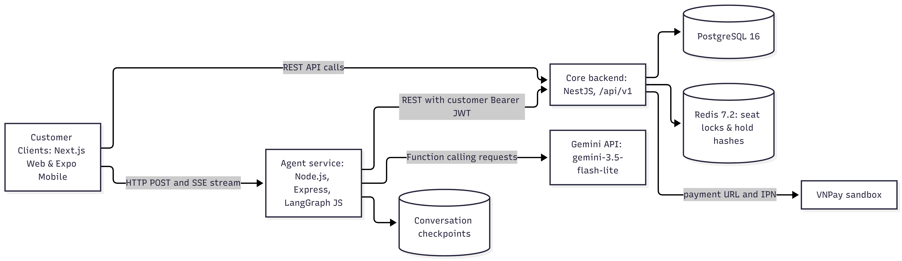
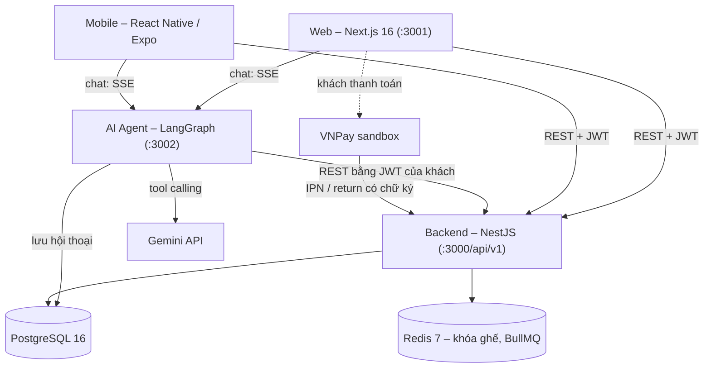
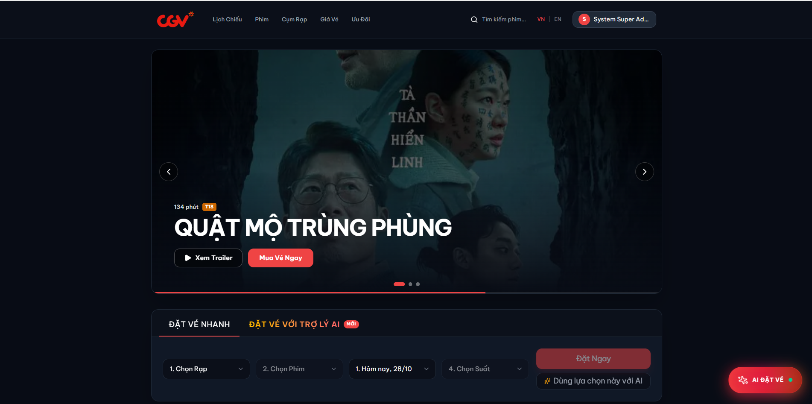
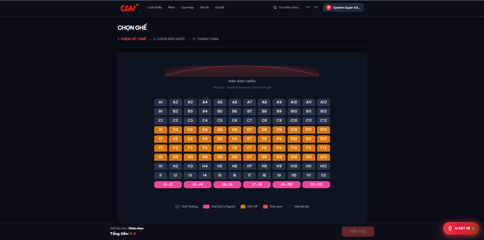
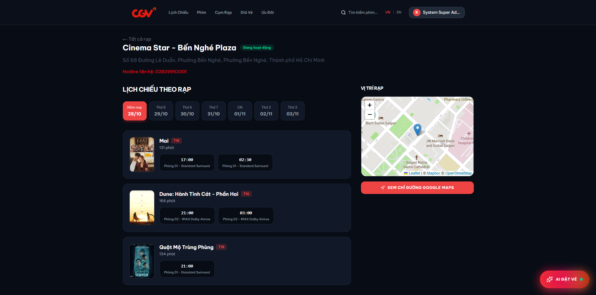
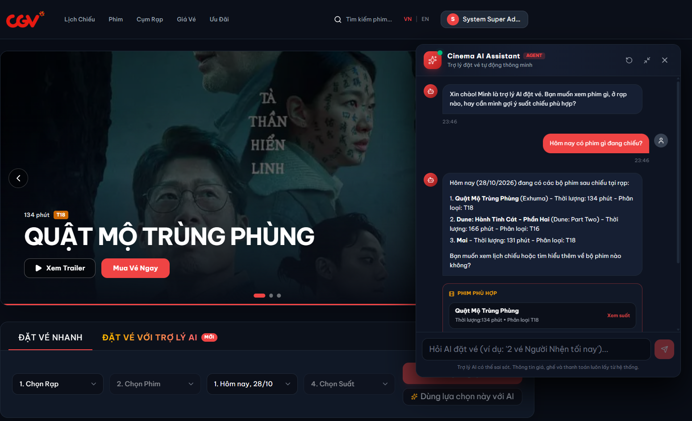
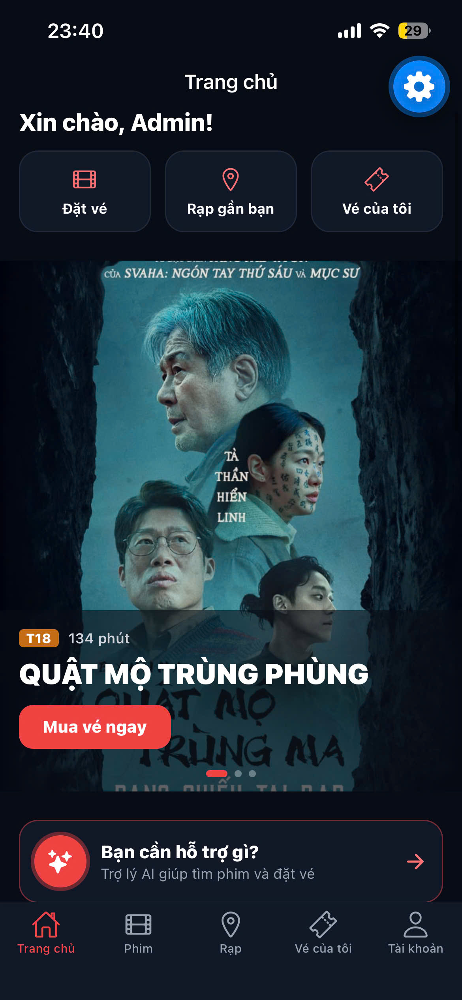
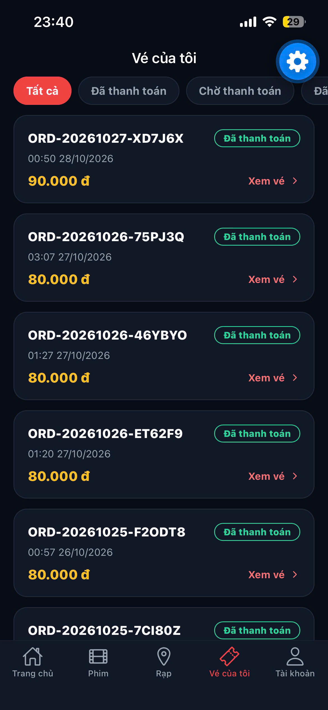
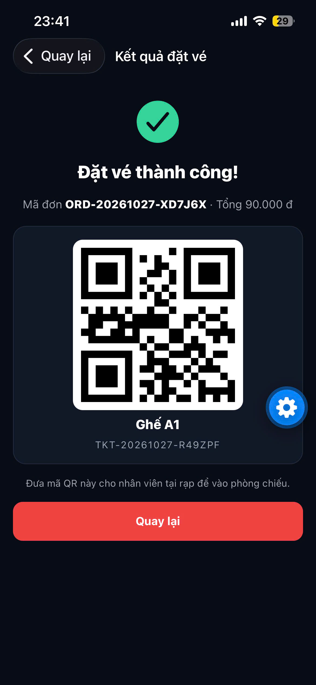
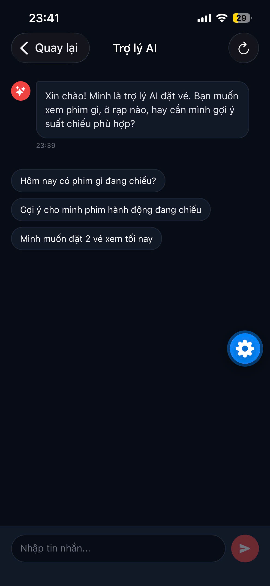

# Cinema Booking Agent

<p align="center">
  
  
  
  
  
  
  
</p>

<p align="center">
  
</p>

> **Cinema Booking Agent** là hệ thống đặt vé xem phim trực tuyến cho khách hàng trên **Web** và **Mobile**, kèm một **trợ lý AI** (LangGraph + Google Gemini) giúp tìm phim, xem suất chiếu, giữ ghế và tạo link thanh toán bằng cách chat tiếng Việt.
>
> Trọng tâm kỹ thuật: **không bán trùng ghế** khi nhiều khách đặt cùng lúc, **thanh toán VNPay an toàn** (chữ ký, thông báo lặp), và **giới hạn quyền của trợ lý AI** – được kiểm chứng bằng integration test trên PostgreSQL thật và 100 kịch bản hội thoại chấm tự động.

---

## Mục lục

- [Điểm nổi bật](#điểm-nổi-bật)
- [Kiến trúc](#kiến-trúc)
- [Các ứng dụng trong monorepo](#các-ứng-dụng-trong-monorepo)
- [Hình ảnh giao diện](#hình-ảnh-giao-diện)
- [Khởi chạy](#khởi-chạy)
- [Kiểm thử và CI](#kiểm-thử-và-ci)
- [Tác giả](#tác-giả)

---

## Điểm nổi bật

1. **Chống bán trùng ghế hai lớp**
   - Redis `SET NX PX` loại nhanh các yêu cầu tranh chấp; PostgreSQL quyết định cuối cùng bằng một câu upsert có điều kiện (all-or-nothing, ghi theo thứ tự `seat_id` để không deadlock).
   - Ghế giữ **11 phút**; khi tạo đơn, ghế được gắn với mã đơn và giữ tới hết hạn thanh toán (10 phút) + 5 phút. Job BullMQ mỗi phút hủy đơn quá hạn và nhả ghế.
   - Lớp cuối: unique index cho vé còn hiệu lực `(showtime_id, seat_id)`; ràng buộc `EXCLUDE` chặn hai suất chiếu trùng giờ trong cùng phòng.
   - Kiểm chứng: 50 request cùng giữ 1 ghế → đúng 1 thành công (`npm run test:int`).
2. **Thanh toán VNPay an toàn**
   - Kiểm tra chữ ký HMAC-SHA512 và số tiền; chuyển trạng thái bằng compare-and-set nên IPN gửi lặp không tạo vé trùng.
   - Thanh toán cho đơn đã hết hạn được đánh dấu chờ hoàn tiền thay vì nhận tiền im lặng; job đối soát xử lý giao dịch bị gián đoạn.
   - Sau khi thanh toán, email vé kèm **mã QR** được gửi qua hàng đợi BullMQ.
3. **Trợ lý AI có giới hạn quyền**
   - Đồ thị LangGraph 2 node, **10 tool** gọi REST API của backend bằng token của chính khách – không truy cập database trực tiếp, không có tool thanh toán.
   - Hỏi xác nhận trước khi tạo đơn; **chốt chặn bằng code** chỉ cho giữ ghế khách đã chọn.
   - Trả lời dạng stream qua **Server-Sent Events**, kèm widget (danh sách phim, sơ đồ ghế, tóm tắt thanh toán); hội thoại lưu trong PostgreSQL.
   - Bộ đánh giá **100 kịch bản** kiểm tra cả tool được gọi lẫn trạng thái database (`npm run eval`).
4. **Backend theo Domain-Driven Design**
   - Mỗi module tách 4 tầng _Domain, Application, Infrastructure, Presentation_; module gọi nhau qua facade/port, không dùng chung repository.
   - Schema quản lý bằng TypeORM migration; CI kiểm tra entity và migration luôn khớp.

---

## Kiến trúc

<p align="center">
  
</p>



---

## Các ứng dụng trong monorepo

Mỗi ứng dụng có `package.json` và workflow CI riêng trong `apps/`.

### 1. Backend API – `apps/cinema-backend`

- **Công nghệ:** NestJS 12, TypeScript, TypeORM, PostgreSQL, Redis, BullMQ, Passport JWT, Winston.
- **Chức năng:** đăng ký/đăng nhập JWT, phân quyền theo vai trò (RBAC); phim, cụm rạp, phòng, sơ đồ ghế (thường/VIP/đôi), suất chiếu, giá vé; giữ ghế, đơn hàng, bắp nước, voucher; thanh toán VNPay; email vé.
- **Bảo mật production:** kiểm tra biến môi trường khi khởi động (từ chối secret mặc định), helmet, CORS theo danh sách, rate limit theo IP.
- **Health check:** `GET /api/v1/health` (PostgreSQL, Redis, bộ nhớ).

### 2. Web – `apps/cinema-frontend-v1`

- **Công nghệ:** Next.js 16 (App Router), React 19, Tailwind CSS 4, TanStack Query 5, Zustand, React Leaflet.
- **Chức năng:** trang chủ, chi tiết phim, suất chiếu theo rạp, bản đồ cụm rạp, sơ đồ ghế, bắp nước và voucher, thanh toán VNPay, vé QR, đăng ký/đăng nhập, khung chat với trợ lý AI.

### 3. Mobile – `apps/cinema-mobile`

- **Công nghệ:** React Native 0.88, Expo SDK 58, expo-router, Expo SecureStore.
- **Chức năng:** luồng đặt vé như web, trailer YouTube, vé điện tử QR, màn hình chat với trợ lý AI.

### 4. AI Agent – `apps/cinema-agent`

- **Công nghệ:** LangGraph JS, LangChain, Express, Google Gemini (`gemini-3.5-flash-lite`), Zod.
- **Chức năng:** tìm phim, xem suất chiếu và ghế trống, giữ/nhả ghế, gợi ý bắp nước, tạo đơn và link VNPay, tra cứu đơn – qua 10 tool có schema; hội thoại theo session, lưu trong PostgreSQL (schema `agent_memory`).

---

## Hình ảnh giao diện

### Web (Next.js 16)

|                              Trang chủ                              |                               Sơ đồ chọn ghế                               |
| :-----------------------------------------------------------------: | :------------------------------------------------------------------------: |
|  |  |

|                                 Bản đồ cụm rạp                                 |                                Trợ lý AI                                |
| :----------------------------------------------------------------------------: | :---------------------------------------------------------------------: |
|  |  |

### Mobile (React Native / Expo)

|                               Trang chủ                                |                                Chi tiết vé                                 |                                  Vé QR                                  |                                 Trợ lý AI                                 |
| :--------------------------------------------------------------------: | :------------------------------------------------------------------------: | :---------------------------------------------------------------------: | :-----------------------------------------------------------------------: |
|  |  |  |  |

---

## Khởi chạy

### Cách 1: Docker Compose (khuyên dùng)

Yêu cầu: **Docker Desktop** (Engine ≥ 24, Compose v2). Chi tiết thêm trong [DOCKER.md](DOCKER.md).

```bash
git clone https://github.com/GiaBaoIT27/cinema-booking-agent.git
cd cinema-booking-agent

# Khóa Gemini cho AI Agent (file .env ở thư mục gốc)
echo "GOOGLE_API_KEY=your_gemini_api_key_here" > .env
# Cấu hình backend (VNPay sandbox, SMTP...)
cp apps/cinema-backend/.env.example apps/cinema-backend/.env

docker compose up -d --build
docker compose ps    # chờ các container ở trạng thái healthy

# Seed dữ liệu mẫu (sau khi backend healthy)
docker compose run --rm backend node -r dotenv/config dist/database/seeds/run-seed.js
```

| Dịch vụ      | Địa chỉ                                                      |
| :----------- | :----------------------------------------------------------- |
| Web          | [http://localhost:3001](http://localhost:3001)               |
| Backend API  | [http://localhost:3000/api/v1](http://localhost:3000/api/v1) |
| AI Agent     | [http://localhost:3002/health](http://localhost:3002/health) |
| RedisInsight | [http://localhost:5540](http://localhost:5540)               |

> **Email vé:** điền `MAIL_USER`, `MAIL_PASSWORD` trong `apps/cinema-backend/.env`. Với Gmail phải dùng **App Password** (tài khoản bật xác minh 2 bước). Sửa `.env` xong chạy `docker compose up -d backend` để container nhận cấu hình mới.

### Cách 2: Chạy từng ứng dụng

```bash
# 1. PostgreSQL + Redis
docker compose up -d postgres redis

# 2. Backend – http://localhost:3000
cd apps/cinema-backend && cp .env.example .env && npm install && npm run start:dev

# 3. Web – http://localhost:3001
cd apps/cinema-frontend-v1 && cp .env.example .env.local && npm install && npm run dev

# 4. AI Agent – http://localhost:3002 (điền GOOGLE_API_KEY trong .env)
cd apps/cinema-agent && cp .env.example .env && npm install && npm run dev

# 5. Mobile – quét QR bằng Expo Go
cd apps/cinema-mobile && cp .env.example .env && npm install && npx expo start -c
```

> **Mobile:** điện thoại không truy cập được `localhost` của máy tính. Trong `apps/cinema-mobile/.env`, đặt `EXPO_PUBLIC_API_URL` và `EXPO_PUBLIC_AGENT_URL` theo **IP LAN** của máy chạy backend; để thanh toán VNPay quay về được, đặt `VNPAY_RETURN_URL` của backend cũng theo IP đó.

---

## Kiểm thử và CI

| Ứng dụng | Lệnh               | Nội dung                                                                                                                       |
| :------- | :----------------- | :----------------------------------------------------------------------------------------------------------------------------- |
| Backend  | `npm test`         | Unit test (Vitest): giữ/nhả ghế, đơn hàng, email vé, thanh toán/IPN, hoàn tiền, lịch chiếu, cấu hình, rate limit               |
| Backend  | `npm run test:int` | Integration test trên **PostgreSQL thật** (DB `cinema_test`): tranh chấp ghế, IPN lặp, compare-and-set, chống trùng suất chiếu |
| Agent    | `npm test`         | Tool, đồ thị, chat handler, chốt chặn giữ ghế, chấm điểm eval (model và backend giả, không gọi LLM thật)                       |
| Agent    | `npm run eval`     | 100 kịch bản hội thoại với Gemini thật, chấm theo tool và trạng thái database (cần `GOOGLE_API_KEY`)                           |
| Web      | `npm test`         | Luồng giữ ghế, checkout, đăng ký (Vitest)                                                                                      |

Mỗi Pull Request và mỗi commit lên `main` chạy workflow GitHub Actions của ứng dụng có thay đổi:

- **Backend CI:** oxlint, TypeScript, unit test, build; job riêng chạy integration test với PostgreSQL 16, áp dụng migration lên DB trống và kiểm tra migration khớp entity.
- **Agent CI:** TypeScript (gồm cả thư mục test), test, build. Bộ eval cần Gemini key nên không chạy trong CI.
- **Frontend CI:** ESLint, TypeScript, unit test, Next.js build.
- **Mobile CI:** Expo lint, TypeScript.

---

## Tác giả

- **Họ và tên:** Nguyễn Gia Bảo (Nguyen Gia Bao)
- **Email:** [bbao270205@gmail.com](mailto:bbao270205@gmail.com)
- **GitHub:** [@GiaBaoIT27](https://github.com/GiaBaoIT27)
- **LinkedIn:** [Bảo Nguyễn](https://www.linkedin.com/in/bao-nguyen-881939301)
- **Trường:** Đại học Tôn Đức Thắng (Ton Duc Thang University – TDTU)
