# Cinema Booking Agent (Smart Cinema Platform)

<p align="center">
  
  
  
  
  
  
  
</p>

---

<p align="center">
  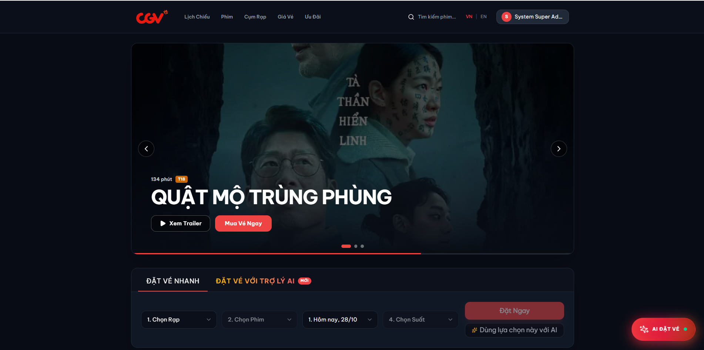
</p>

> **Cinema Booking Agent** là nền tảng quản trị rạp và đặt vé xem phim trực tuyến đa kênh (Web, Mobile) ứng dụng kiến trúc **Monorepo (Turborepo)**, tích hợp **Trợ lý ảo AI (LangGraph + Google Gemini)** hỗ trợ tìm kiếm phim và đặt vé thông minh qua ngôn ngữ tự nhiên.
>
> Hệ thống giải quyết triệt để bài toán **High-Concurrency Seat Booking** (tránh trùng ghế đồng thời) bằng giải thuật **Distributed Locking (Redlock over Redis)** và quản lý hàng đợi bất đồng bộ với **BullMQ**.

---

## 📑 Mục Lục

- [Cinema Booking Agent (Smart Cinema Platform)](#cinema-booking-agent-smart-cinema-platform)
  - [📑 Mục Lục](#-mục-lục)
  - [Điểm Nổi Bật Hệ Thống](#điểm-nổi-bật-hệ-thống)
  - [Kiến Trúc Tổng Thể](#kiến-trúc-tổng-thể)
  - [Hệ Sinh Thái Ứng Dụng (Monorepo Apps)](#hệ-sinh-thái-ứng-dụng-monorepo-apps)
    - [1. Backend API (`apps/cinema-backend`)](#1-backend-api-appscinema-backend)
    - [2. Web Customer Portal (`apps/cinema-frontend-v1`)](#2-web-customer-portal-appscinema-frontend-v1)
    - [3. Mobile Application (`apps/cinema-mobile`)](#3-mobile-application-appscinema-mobile)
    - [4. Conversational AI Agent (`apps/cinema-agent`)](#4-conversational-ai-agent-appscinema-agent)
  - [📸 Hình Ảnh Giao Diện \& Demo](#-hình-ảnh-giao-diện--demo)
    - [1. Giao Diện Web Portal (Next.js 16)](#1-giao-diện-web-portal-nextjs-16)
    - [2. Giao Diện Mobile App (React Native / Expo)](#2-giao-diện-mobile-app-react-native--expo)
  - [Hướng Dẫn Khởi Chạy (Quick Start)](#hướng-dẫn-khởi-chạy-quick-start)
    - [Cách 1: Khởi chạy toàn bộ bằng Docker Compose (Khuyên dùng)](#cách-1-khởi-chạy-toàn-bộ-bằng-docker-compose-khuyên-dùng)
    - [Cách 2: Khởi chạy từng ứng dụng ở môi trường Local Development](#cách-2-khởi-chạy-từng-ứng-dụng-ở-môi-trường-local-development)
      - [1. Khởi động PostgreSQL \& Redis (qua Docker)](#1-khởi-động-postgresql--redis-qua-docker)
      - [2. Khởi động Backend (`apps/cinema-backend`)](#2-khởi-động-backend-appscinema-backend)
      - [3. Khởi động Frontend Web (`apps/cinema-frontend-v1`)](#3-khởi-động-frontend-web-appscinema-frontend-v1)
      - [4. Khởi động Mobile App (`apps/cinema-mobile`)](#4-khởi-động-mobile-app-appscinema-mobile)
      - [5. Khởi động AI Agent (`apps/cinema-agent`)](#5-khởi-động-ai-agent-appscinema-agent)
  - [Kiểm Thử \& CI/CD](#kiểm-thử--cicd)
    - [Chạy Unit Test Backend (Vitest)](#chạy-unit-test-backend-vitest)
    - [GitHub Actions CI Workflow](#github-actions-ci-workflow)
  - [Tác Giả \& Bản Quyền](#tác-giả--bản-quyền)

---

## Điểm Nổi Bật Hệ Thống

1. **Khóa phân tán chống đặt trùng ghế (Distributed Locking with Redlock):**
   - Đảm bảo tính nhất quán dữ liệu (Data Consistency) tuyệt đối khi hàng ngàn người dùng cùng click chọn một ghế tại cùng một miligiây.
   - Cơ chế tự động giải phóng ghế (Auto-release Hold) sau 5 phút nếu khách hàng không hoàn tất bước thanh toán.
2. **Hàng đợi tác vụ bất đồng bộ (BullMQ + Redis):**
   - Tự động hủy đơn hàng quá hạn thanh toán mà không làm block luồng HTTP chính.
   - Gửi email xác nhận đặt vé kèm mã QR-Code tự động thông qua worker chạy nền.
3. **Trợ lý AI Đàm thoại thông minh (Stateful Graph Agent):**
   - Xây dựng bằng **LangGraph** (State Machine Agent) kết hợp mô hình ngôn ngữ lớn **Google Gemini**.
   - Phản hồi thời gian thực qua giao thức **Server-Sent Events (SSE)** kèm hiệu ứng gõ phím mượt mà.
   - Tự động gọi API nội bộ (Tool Calling) để tra cứu lịch chiếu, giá vé và đề xuất phim theo sở thích.
4. **Kiến trúc Domain-Driven Design (DDD):**
   - Backend phân tách 4 tầng nghiêm ngặt: _Domain, Application, Infrastructure, Presentation_.
   - Giao tiếp liên-module thông qua **Facade Pattern**, loại bỏ triệt để phụ thuộc chéo (Circular Dependency).

---

## Kiến Trúc Tổng Thể

Hệ thống được tổ chức theo mô hình **Turborepo Monorepo** với kiến trúc đa tầng (Multi-tier Architecture):

<p align="center">
  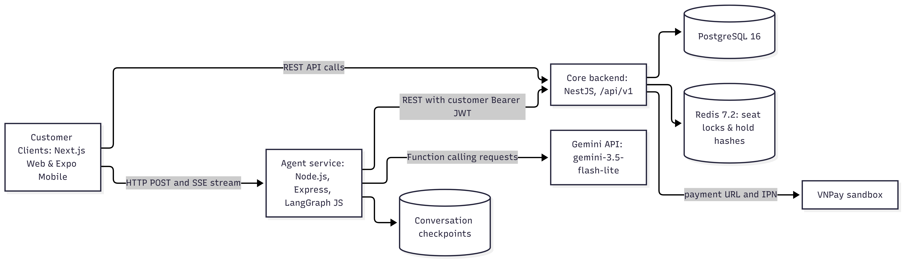
</p>

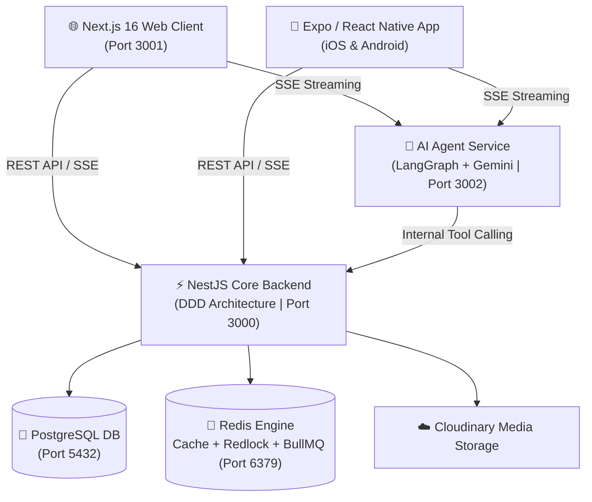

---

## Hệ Sinh Thái Ứng Dụng (Monorepo Apps)

### 1. Backend API (`apps/cinema-backend`)

- **Framework:** NestJS 11, TypeScript, TypeORM, Passport.js, Winston Logger.
- **Tính năng cốt lõi:**
  - Xác thực **JWT với Access Token & Refresh Token Rotation**.
  - Phân quyền theo vai trò **RBAC (Admin, Staff, Customer)**.
  - Quản lý rạp (Cineplex, Cinema, Hall, Seat Matrix VIP/Regular/Sweetbox).
  - Quản lý phim, lịch chiếu, giá vé linh hoạt theo khung giờ và ngày lễ.
  - Thanh toán tích hợp cổng **VNPay** với xử lý IPN Idempotency.
  - Endpoint kiểm tra sức khỏe hệ thống: `/api/v1/health` (Postgres, Redis, Memory RAM).
  - Bộ kiểm thử **Vitest 32 unit tests (100% pass)** bao phủ toàn bộ Domain Rules & Payment Service.

### 2. Web Customer Portal (`apps/cinema-frontend-v1`)

- **Framework:** Next.js 16 (App Router, Server Components), React 19, Tailwind CSS.
- **Tính năng cốt lõi:**
  - Quản lý Server State với **TanStack Query v5** (Optimistic updates, Stale-while-revalidate, Pagination).
  - Quản lý Client State bằng **Zustand**.
  - Hero Slider tùy biến 100% (Progress bar, Auto-advance, không phụ thuộc thư viện bên ngoài).
  - Định vị rạp chiếu trực quan trên bản đồ tương tác với **React Leaflet**.
  - Widget chat AI đặt vé xem phim thời gian thực (SSE Streaming).
  - Xử lý lỗi toàn diện với **Global Error Boundary (`error.tsx`)** và trang **404 (`not-found.tsx`)**.

### 3. Mobile Application (`apps/cinema-mobile`)

- **Framework:** React Native, Expo SDK, Expo Router v3 (File-based Navigation).
- **Tính năng cốt lõi:**
  - Hỗ trợ đa nền tảng **iOS & Android** với giao diện Dark Mode cao cấp.
  - Lưu trữ Token bảo mật bằng **Expo SecureStore**.
  - Xem trailer trực tiếp trong ứng dụng qua YouTube Player.
  - Hiển thị vé điện tử kèm **mã QR-Code** dùng để check-in tại quầy rạp.
  - Màn hình chat chuyên biệt với AI Agent phản hồi dạng stream thời gian thực.

### 4. Conversational AI Agent (`apps/cinema-agent`)

- **Framework:** LangGraph (Stateful Graph), LangChain, Express.js, Google Gemini API.
- **Tính năng cốt lõi:**
  - Nhận diện ý định người dùng (Intent Recognition): tìm phim, xem lịch chiếu theo rạp, hỏi giá vé.
  - Duy trì ngữ cảnh hội thoại theo từng Session ID.
  - Gọi công cụ an toàn (Safe Tool Calling) vào Backend để lấy dữ liệu thực tế.

---

## 📸 Hình Ảnh Giao Diện & Demo

### 1. Giao Diện Web Portal (Next.js 16)

|                         Trang chủ & Hero Banner                         |                          Sơ đồ chọn ghế thời gian thực                          |
| :---------------------------------------------------------------------: | :-----------------------------------------------------------------------------: |
|  | 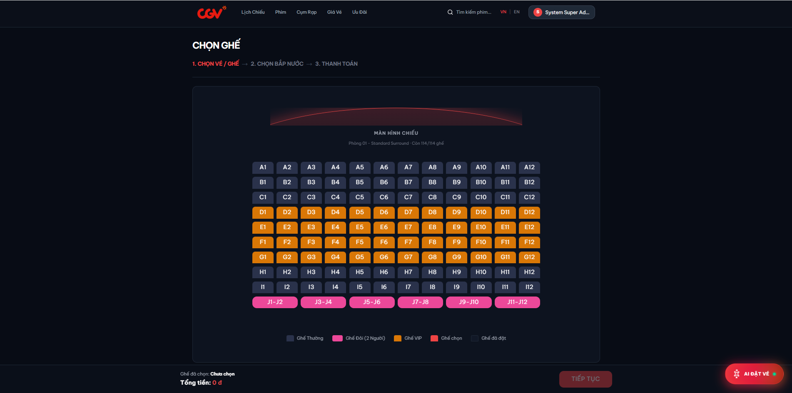 |

|                           Bản đồ cụm rạp GIS (React Leaflet)                           |                      Trợ lý ảo AI Chatbot (SSE Streaming)                      |
| :------------------------------------------------------------------------------------: | :----------------------------------------------------------------------------: |
| 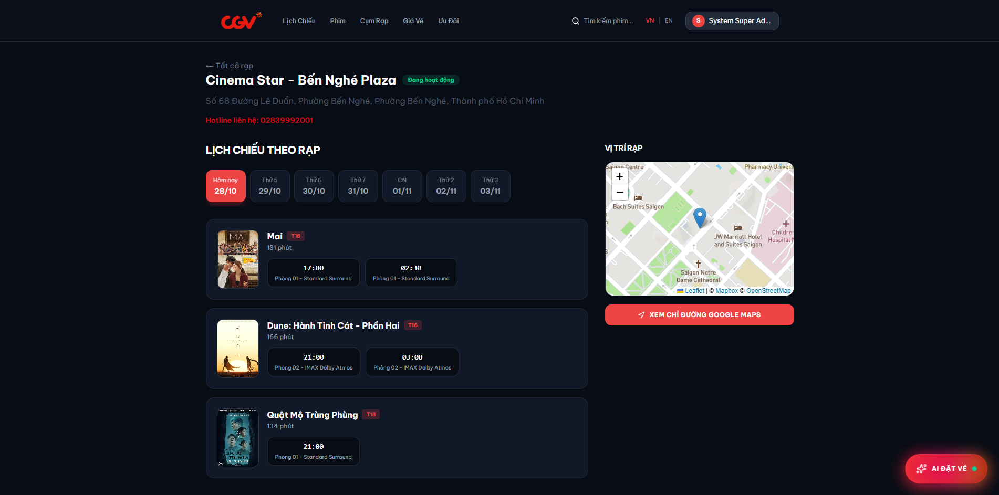 | 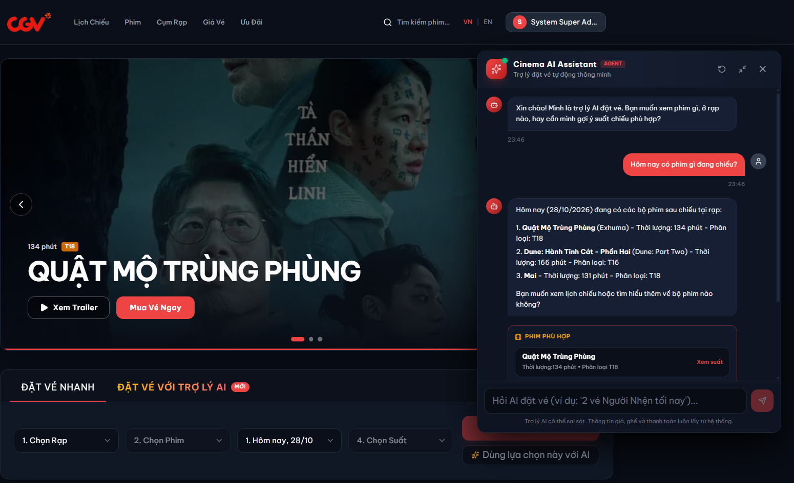 |

---

### 2. Giao Diện Mobile App (React Native / Expo)

|                              🏠 Trang chủ Mobile                              |                             🎟️ Chi tiết đặt vé                             |                            📱 Vé điện tử QR Check-in                            |                              🤖 Chatbot AI Assistant                              |
| :---------------------------------------------------------------------------: | :------------------------------------------------------------------------: | :-----------------------------------------------------------------------------: | :-------------------------------------------------------------------------------: |
| 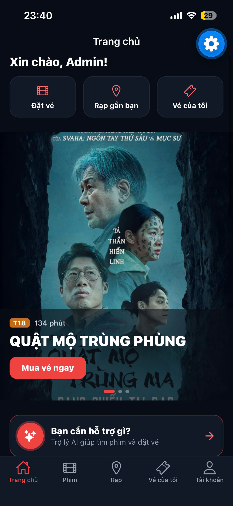 | 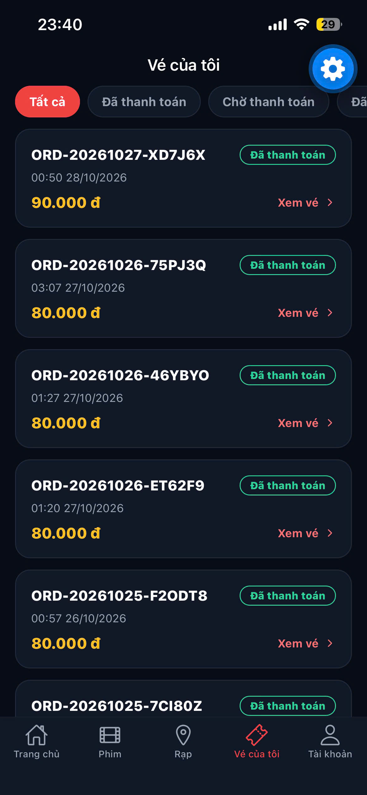 | 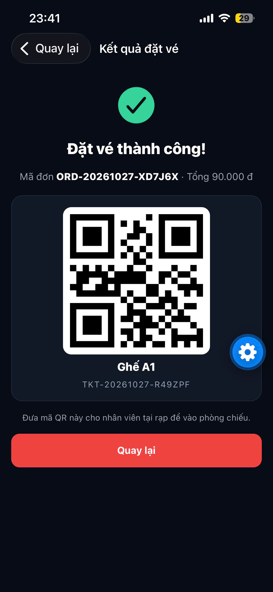 | 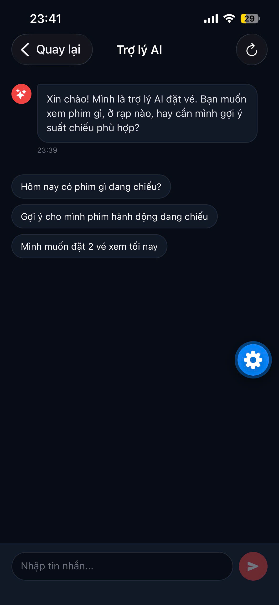 |

---

## Hướng Dẫn Khởi Chạy (Quick Start)

### Cách 1: Khởi chạy toàn bộ bằng Docker Compose (Khuyên dùng)

Yêu cầu: Đã cài đặt **Docker Desktop** (Engine ≥ 24) và **Docker Compose v2**.

```bash
# 1. Clone repository
git clone https://github.com/GiaBaoIT27/cinema-booking-agent.git
cd cinema-booking-agent

# 2. (Tùy chọn) Khởi tạo biến môi trường cho AI Agent
# Tạo file .env ở thư mục gốc:
echo "GOOGLE_API_KEY=your_gemini_api_key_here" > .env

# 3. Khởi chạy toàn bộ hệ thống
docker compose up -d --build

# 4. Kiểm tra trạng thái các container (chờ healthy)
docker compose ps
```

**Các cổng dịch vụ mặc định:**

- **Web Frontend:** [http://localhost:3001](http://localhost:3001)
- **Backend API:** [http://localhost:3000/api/v1](http://localhost:3000/api/v1)
- **AI Agent Service:** [http://localhost:3002/health](http://localhost:3002/health)
- **RedisInsight (Quản lý Redis):** [http://localhost:5540](http://localhost:5540)

**Seed dữ liệu mẫu ban đầu:**

```bash
docker compose run --rm backend node -r dotenv/config dist/database/seeds/run-seed.js
```

---

### Cách 2: Khởi chạy từng ứng dụng ở môi trường Local Development

#### 1. Khởi động PostgreSQL & Redis (qua Docker)

```bash
docker compose up -d postgres redis
```

#### 2. Khởi động Backend (`apps/cinema-backend`)

```bash
cd apps/cinema-backend
cp .env.example .env
npm install
npm run start:dev
# Backend chạy tại http://localhost:3000
```

#### 3. Khởi động Frontend Web (`apps/cinema-frontend-v1`)

```bash
cd apps/cinema-frontend-v1
cp .env.example .env.local
npm install
npm run dev
# Web chạy tại http://localhost:3001
```

#### 4. Khởi động Mobile App (`apps/cinema-mobile`)

```bash
cd apps/cinema-mobile
npm install
npx expo start
# Quét mã QR bằng ứng dụng Expo Go trên điện thoại iOS / Android
```

#### 5. Khởi động AI Agent (`apps/cinema-agent`)

```bash
cd apps/cinema-agent
cp .env.example .env # Điền GOOGLE_API_KEY
npm install
npm run dev
# Agent chạy tại http://localhost:3002
```

---

## Kiểm Thử & CI/CD

### Chạy Unit Test Backend (Vitest)

```bash
cd apps/cinema-backend
npm run test
```

<p align="center">
  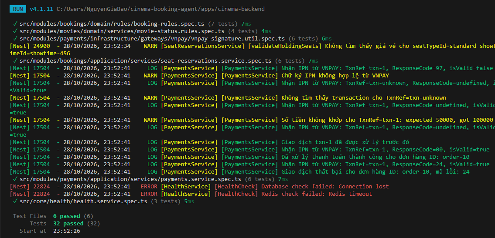
</p>

_Kết quả: **32/32 tests pass (100%)** bao phủ toàn diện Booking Rules, Seat Reservations, Payment Idempotency, và Health Service._

### GitHub Actions CI Workflow

Mỗi Pull Request và commit lên nhánh `main` đều tự động kích hoạt workflow:

- `Backend CI`: Chạy lint, TypeScript compilation, và chạy toàn bộ bộ test Vitest.
- `Frontend CI`: Kiểm tra format Prettier, ESLint (0 errors, 0 warnings), và Next.js production build.

---

## Tác Giả & Bản Quyền

- **Họ và tên:** Nguyễn Gia Bảo (Nguyen Gia Bao)
- **Email:** [bbao270205@gmail.com](mailto:bbao270205@gmail.com)
- **GitHub:** [@GiaBaoIT27](https://github.com/GiaBaoIT27)
- **LinkedIn:** [Bảo Nguyễn](https://www.linkedin.com/in/bao-nguyen-881939301)
- **Trường:** Đại học Tôn Đức Thắng (Ton Duc Thang University - TDTU)

---

<p align="center">
  <i>Được phát triển với niềm đam mê dành cho Software Engineering & Modern Fullstack Architectures 🚀</i>
</p>
