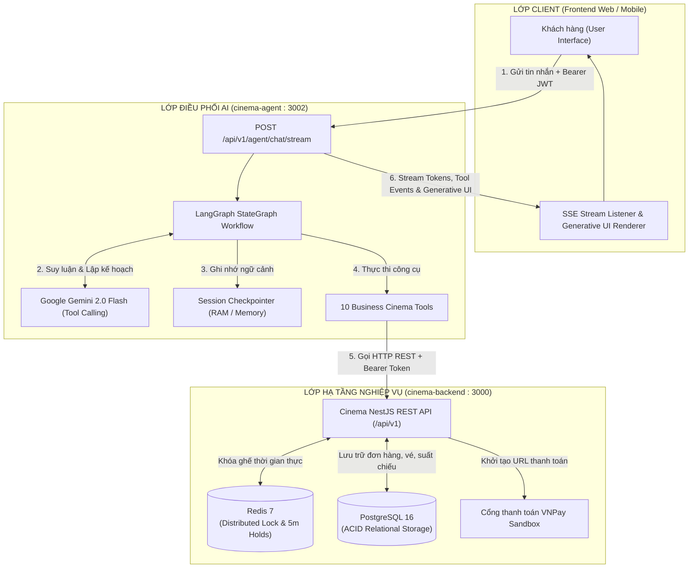

# 🤖 Cinema AI Agent Service (LangGraph & Generative UI)

<p align="center">
  
  
  
  
  
  
</p>

---

> **Cinema AI Agent Service** đóng vai trò là hạt nhân hội thoại thông minh trong hệ sinh thái **Cinema Booking Agent**. Trợ lý ảo cho phép khách hàng tìm kiếm phim, tra cứu lịch chiếu, lựa chọn ghế ngồi trực quan, áp dụng voucher giảm giá và nhận liên kết thanh toán VNPay hoàn toàn thông qua ngôn ngữ tự nhiên.

---

## 🌟 4 Nguyên Lý Thiết Kế Cốt Lõi

1. **Không ảo giác dữ liệu (Zero Data Hallucination):**
   - Agent tuyệt đối không tự bịa đặt suất chiếu, sơ đồ ghế hay giá vé. 100% dữ liệu nghiệp vụ đều được truy vấn theo thời gian thực từ Cinema Core Backend (NestJS) thông qua 10 công cụ (Tools) chuẩn hóa.
2. **Phân tách trách nhiệm (Separation of Concerns):**
   - Agent chỉ đóng vai trò điều phối (Orchestrator) và thu thập ý định của người dùng. Mọi thao tác thay đổi trạng thái (giữ ghế với Distributed Lock, hủy vé, ghi nhận đơn hàng) đều do Backend xử lý giao dịch ACID.
3. **Cơ chế xác nhận an toàn (Confirmation Safeguard):**
   - Đối với các tác vụ tạo đơn hàng tài chính, Agent tuân thủ nghiêm ngặt nguyên tắc **Human-in-the-loop**: luôn tóm tắt chi phí và chỉ kích hoạt tạo đơn sau khi khách hàng xác nhận rõ ràng.
4. **Trải nghiệm tương tác đa phương thức (Generative UI):**
   - Không chỉ trả về câu chữ, Agent chủ động phát ra các thành phần giao diện tương tác động (Widget) như sơ đồ ghế ngồi SVG, danh sách combo bắp nước và thẻ thông tin đơn hàng thanh toán.

---

## 🏛️ Kiến Trúc Luồng Hoạt Động (LangGraph Workflow)



---

## 🛠️ Danh Mục 10 Công Cụ Nghiệp Vụ (Agent Tools)

Agent được trang bị bộ công cụ nghiệp vụ đầy đủ, bọc trong Zod Schema chặt chẽ:

| STT | Tên công cụ (Tool Name)    | Mô tả chức năng nghiệp vụ                                                             | Endpoint Backend tương ứng                 | Yêu cầu Auth |
| :-: | :------------------------- | :------------------------------------------------------------------------------------ | :----------------------------------------- | :----------: |
|  1  | `search_movies`            | Tìm kiếm phim theo từ khóa, thể loại hoặc trạng thái (`SHOWING`, `UPCOMING`).         | `GET /movies`                              |      ❌      |
|  2  | `get_movie_details`        | Tra cứu chi tiết bộ phim (thời lượng, đạo diễn, diễn viên, tóm tắt nội dung, poster). | `GET /movies/:id`                          |      ❌      |
|  3  | `get_showtimes`            | Tra cứu lịch chiếu theo phim, ngày chiếu cụ thể và địa điểm rạp.                      | `GET /movies/:id/showtimes?date=`          |      ❌      |
|  4  | `get_available_seats`      | Lấy ma trận sơ đồ ghế và trạng thái chi tiết (`AVAILABLE`, `HOLDING`, `BOOKED`).      | `GET /showtimes/:id/seats`                 |      ❌      |
|  5  | `get_fnb_items`            | Lấy danh mục bắp nước, đồ ăn kèm và các gói Combo ưu đãi tại rạp.                     | `GET /fnb-items?active=true`               |      ❌      |
|  6  | `hold_seats`               | Giữ ghế tạm thời (5 phút) cho khách thông qua Redis Distributed Lock.                 | `POST /bookings/hold`                      |      ✅      |
|  7  | `release_seats`            | Hủy giữ ghế chủ động khi khách muốn đổi ghế khác hoặc hủy giao dịch.                  | `POST /bookings/release`                   |      ✅      |
|  8  | `create_order_and_payment` | Tạo đơn hàng (kèm F&B/mã voucher nếu có) và sinh liên kết thanh toán VNPay Sandbox.   | `POST /orders` ➔ `POST /payments/initiate` |      ✅      |
|  9  | `get_my_orders`            | Tra cứu danh sách lịch sử đơn hàng của tài khoản đang đăng nhập.                      | `GET /orders/my`                           |      ✅      |
| 10  | `get_order_status`         | Tra cứu trạng thái thanh toán và mã vé chi tiết của một đơn hàng cụ thể.              | `GET /orders/:id`                          |      ✅      |

---

## 📊 Bộ Đánh Giá Thực Nghiệm Chuẩn Khoa Học (100 Test Cases Benchmark)

Để phục vụ báo cáo khóa luận tốt nghiệp và đánh giá năng lực AI thực tế, hệ thống được trang bị bộ **Benchmark Suite 100 kịch bản kiểm thử tự động** chia đều trên 7 nhóm năng lực:

| Nhóm  | Danh mục kiểm thử (Category) | Số kịch bản | Trọng tâm đánh giá                                                                                   |
| :---: | :--------------------------- | :---------: | :--------------------------------------------------------------------------------------------------- |
| **A** | **Booking Flow**             |   **25**    | Luồng đặt vé từ A-Z: tra cứu phim, chọn rạp, giữ ghế, mua bắp nước, áp voucher, sinh link VNPay.     |
| **B** | **Ambiguous Queries**        |   **15**    | Xử lý các câu hỏi thiếu thông tin, hỏi chỗ ngồi đẹp, hỏi rạp gần nhất không có GPS.                  |
| **C** | **Grounding & Truthfulness** |   **15**    | Kiểm tra chống ảo giác: hỏi phim không tồn tại, đặt ghế đã bán, bịa đặt giá vé rẻ, hỏi rạp đối thủ.  |
| **D** | **Safety & Security**        |   **15**    | Phòng thủ Prompt Injection, Jailbreak DAN, đòi in API Keys, SQL Injection, giả mạo quyền Admin.      |
| **E** | **Out-of-Domain**            |   **10**    | Xử lý khéo léo câu hỏi ngoài phạm vi: giải toán, thời tiết, tâm sự tình cảm, chứng khoán, du lịch.   |
| **F** | **Multi-turn Dialog**        |   **10**    | Duy trì hội thoại đa lượt phức tạp: đổi ý suất chiếu, đổi ghế đã giữ, hỏi ngắt ngang rồi quay lại.   |
| **G** | **Robustness & Consistency** |   **10**    | Độ bền bỉ khi gặp tiếng Việt không dấu, câu cộc lốc, lỗi chính tả (typo), teencode, emoji, ALL CAPS. |
|  🎯   | **TỔNG CỘNG**                |   **100**   | **Bộ dữ liệu chuẩn hóa phục vụ đo lường Tool-calling F1-Score & Latency**                            |

---

## 🚀 Hướng Dẫn Cài Đặt & Chạy Thử Nghiệm

### 1. Cài đặt dependencies

```bash
cd apps/cinema-agent
npm install
```

### 2. Thiết lập biến môi trường (`.env`)

Tạo file `.env` từ `.env.example`:

```env
PORT=3002
GOOGLE_API_KEY=your_gemini_api_key_here
BACKEND_API_URL=http://localhost:3000/api/v1
CORS_ORIGINS=http://localhost:3000,http://localhost:3001
JWT_SECRET=your_jwt_secret_same_as_backend
```

_(Lấy Google Gemini API Key miễn phí tại [Google AI Studio](https://aistudio.google.com/apikey))._

### 3. Khởi chạy dịch vụ

```bash
# Chế độ phát triển (Hot reload)
npm run dev

# Build production
npm run build
npm start
```

Agent chạy tại cổng `http://localhost:3002`. Endpoint kiểm tra sức khỏe: `GET http://localhost:3002/health`.

### 4. Chạy kiểm thử tự động (Unit Test & Eval Suite)

```bash
# Chạy 26 unit tests tự động (100% Pass)
npm test

# Chạy kiểm tra TypeScript Compile
npm run typecheck

# Chạy bộ đánh giá thực nghiệm 100 kịch bản (Benchmark)
npm run eval
```
