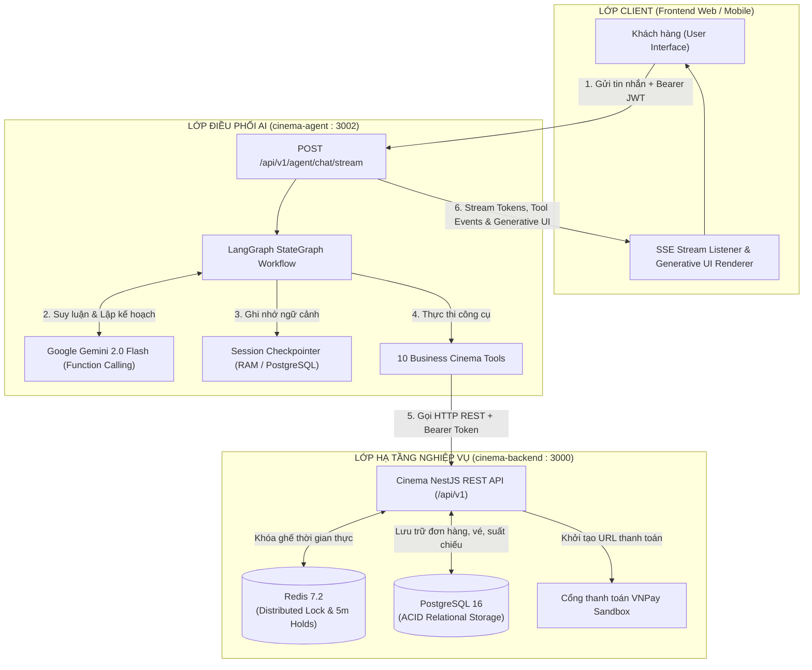

# 🎬 Cinema AI Agent Service

> Trợ lý AI tư vấn và điều phối đặt vé xem phim thông minh, xây dựng trên nền tảng **LangGraph JS**, mô hình **Google Gemini (Function Calling)** và tích hợp **Generative UI** thời gian thực qua giao thức **Server-Sent Events (SSE)**.

[](https://www.typescriptlang.org/)
[](https://langchain-ai.github.io/langgraphjs/)
[](https://ai.google.dev/)
[](https://expressjs.com/)
[](LICENSE)

---

## 📌 1. Tổng quan dự án

**Cinema AI Agent Service** đóng vai trò là hạt nhân hội thoại thông minh trong Hệ sinh thái Cinema Booking. Agent giúp người dùng tìm kiếm phim, tra cứu lịch chiếu, lựa chọn ghế ngồi trực quan, áp dụng mã giảm giá và khởi tạo giao dịch thanh toán VNPay hoàn toàn qua ngôn ngữ tự nhiên.

### Nguyên lý thiết kế cốt lõi

- **Không ảo giác dữ liệu (Zero Data Hallucination):** Agent không bao giờ tự bịa đặt suất chiếu, sơ đồ ghế hay giá vé. 100% dữ liệu nghiệp vụ đều được truy vấn theo thời gian thực từ Cinema Core Backend NestJS thông qua 10 công cụ chuẩn hóa.
- **Phân tách trách nhiệm (Separation of Concerns):** Agent chỉ đóng vai trò điều phối (Orchestrator) và thu thập ý định của người dùng. Mọi thao tác thay đổi trạng thái (giữ ghế, khóa phân tán Redis, ghi nhận đơn hàng, thanh toán) đều do Backend xử lý giao dịch ACID và xác nhận tính hợp lệ.
- **Cơ chế xác nhận an toàn (Confirmation Safeguard):** Đối với các tác vụ tạo đơn hàng tài chính, Agent tuân thủ nghiêm ngặt nguyên tắc Human-in-the-loop: luôn tóm tắt chi phí và chỉ kích hoạt tạo đơn sau khi khách hàng xác nhận rõ ràng.
- **Trải nghiệm tương tác đa phương thức (Generative UI):** Không chỉ trả về câu chữ, Agent chủ động phát ra các thành phần giao diện tương tác động (Widget) như sơ đồ ghế ngồi SVG, danh sách combo bắp nước và thẻ thông tin đơn hàng thanh toán.

---

## 🏗️ 2. Kiến trúc hệ thống



---

## 🛠️ 3. Danh mục 10 Công cụ Nghiệp vụ (Agent Tools)

Agent được trang bị bộ công cụ nghiệp vụ đầy đủ, bọc trong Zod Schema chặt chẽ:

| STT | Tên công cụ (Tool Name)    | Mô tả chức năng nghiệp vụ                                                             | Endpoint Backend tương ứng                             | Yêu cầu Auth |
| :-: | :------------------------- | :------------------------------------------------------------------------------------ | :----------------------------------------------------- | :----------: |
|  1  | `search_movies`            | Tìm kiếm phim theo từ khóa, thể loại hoặc trạng thái (`NOW_SHOWING`, `COMING_SOON`).  | `GET /movies`                                          |      ❌      |
|  2  | `get_movie_details`        | Tra cứu chi tiết bộ phim (thời lượng, đạo diễn, diễn viên, tóm tắt nội dung, poster). | `GET /movies/:id`                                      |      ❌      |
|  3  | `get_showtimes`            | Tra cứu lịch chiếu theo phim, ngày chiếu cụ thể và địa điểm rạp.                      | `GET /movies/:id/showtimes?date=`                      |      ❌      |
|  4  | `get_available_seats`      | Lấy ma trận sơ đồ ghế và trạng thái chi tiết (`AVAILABLE`, `HOLDING`, `BOOKED`).      | `GET /showtimes/:id/seats`                             |      ❌      |
|  5  | `get_fnb_items`            | Lấy danh mục bắp nước, đồ ăn kèm và các gói Combo ưu đãi tại rạp.                     | `GET /fnb-items?active=true`                           |      ❌      |
|  6  | `hold_seats`               | Giữ ghế tạm thời (5 phút) cho khách thông qua Redis Distributed Lock.                 | `POST /bookings/hold`                                  |      ✅      |
|  7  | `release_seats`            | Hủy giữ ghế chủ động khi khách muốn đổi ghế khác hoặc hủy giao dịch.                  | `POST /bookings/release`                               |      ✅      |
|  8  | `create_order_and_payment` | Tạo đơn hàng (kèm F&B/mã voucher nếu có) và sinh liên kết thanh toán VNPay Sandbox.   | `POST /orders` $\rightarrow$ `POST /payments/initiate` |      ✅      |
|  9  | `get_my_orders`            | Tra cứu danh sách lịch sử đơn hàng của tài khoản đang đăng nhập.                      | `GET /orders/my`                                       |      ✅      |
| 10  | `get_order_status`         | Tra cứu trạng thái thanh toán và mã vé chi tiết của một đơn hàng cụ thể.              | `GET /orders/:id`                                      |      ✅      |

### Điểm nổi bật trong xử lý công cụ:

- **Phân giải nhãn ghế tự nhiên (Seat Label Resolver):** Người dùng chỉ cần nói _"giữ ghế H7, H8"_ hoặc _"ghế đôi Sweetbox J1-J2"_, bộ tiện ích của Agent tự động đối chiếu ma trận ghế của suất chiếu để ánh xạ thành `seatId` dạng số chuẩn xác cho cơ sở dữ liệu.
- **Bảo mật Token JWT (Token Passthrough):** Token của khách hàng được truyền qua header `Authorization: Bearer <token>`, Agent chỉ chuyển tiếp minh bạch sang Backend để xác thực danh tính. Mô hình Gemini hoàn toàn không nhìn thấy và không thể can thiệp sửa đổi JWT.

---

## 📡 4. Giao thức Server-Sent Events (SSE) & Generative UI

Agent giao tiếp hai chiều với Frontend thông qua giao thức Server-Sent Events thời gian thực tại endpoint:

```http
POST /api/v1/agent/chat/stream
Content-Type: application/json
Authorization: Bearer <JWT_ACCESS_TOKEN> (tùy chọn)

{
  "message": "Ngày mai có suất phim Mai nào lúc 10:00 không bạn?",
  "sessionId": "session-1792426800"
}
```

### Các sự kiện luồng (SSE Events):

| Tên Event    | Dữ liệu Payload                                       | Mục đích hiển thị Frontend                                                       |
| :----------- | :---------------------------------------------------- | :------------------------------------------------------------------------------- |
| `session`    | `{ "sessionId": "..." }`                              | Định danh phiên hội thoại để duy trì ngữ cảnh cho các lượt sau.                  |
| `token`      | `{ "text": "..." }`                                   | Từng từ/cụm từ mô hình sinh ra để hiển thị hiệu ứng gõ phím tức thì.             |
| `tool_start` | `{ "name": "get_showtimes" }`                         | Báo hiệu Agent đang tra cứu dữ liệu (hiển thị spinner "Đang tìm suất chiếu..."). |
| `tool_end`   | `{ "name": "get_showtimes", "ok": true }`             | Báo hiệu công cụ đã hoàn tất trích xuất dữ liệu.                                 |
| `ui_widget`  | `{ "type": "...", "title": "...", "payload": {...} }` | Dữ liệu cấu trúc để Frontend render component giao diện động.                    |
| `state_sync` | `{ "movieId": 1, "showtimeId": 1916, ... }`           | Đồng bộ trạng thái ngữ cảnh đặt vé hiện tại về client state.                     |
| `error`      | `{ "message": "..." }`                                | Thông báo lỗi nghiệp vụ hoặc kết nối.                                            |
| `end`        | `{ "status": "COMPLETED" \| "FAILED" }`               | Đánh dấu kết thúc lượt hội thoại.                                                |

### Các loại Widget Generative UI hỗ trợ:

1. `MOVIE_LIST`: Danh sách thẻ phim đang chiếu kèm poster, thời lượng, thể loại.
2. `SHOWTIME_SELECTOR`: Bộ chọn giờ chiếu theo rạp, định dạng phòng chiếu (Standard, IMAX).
3. `SEAT_MATRIX_SELECTOR`: Sơ đồ ghế tương tác trực quan thời gian thực (hỗ trợ chế độ xem ghế trống `AVAILABILITY` hoặc xem ghế vừa giữ `HELD`).
4. `FNB_SELECTOR`: Menu combo bắp rang, nước ngọt kèm bộ nút tăng giảm số lượng.
5. `PAYMENT_SUMMARY`: Thẻ tóm tắt đơn hàng (tổng tiền, giảm giá) kèm nút bấm điều hướng thanh toán `paymentUrl` của VNPay.
6. `LOGIN_REQUIRED`: Hộp thoại yêu cầu đăng nhập khi khách vãng lai gọi các thao tác nhạy cảm (giữ ghế, tạo đơn).

---

## 🚀 5. Hướng dẫn cài đặt & Vận hành

### Yêu cầu tiên quyết

- **Node.js:** v20.x hoặc mới hơn
- **Google AI API Key:** Lấy từ [Google AI Studio](https://aistudio.google.com/apikey)
- **Cinema Backend:** Dịch vụ backend chạy tại cổng `3000` (hoặc qua Docker Compose)

### 1. Cấu hình biến môi trường

Tạo file `.env` từ file mẫu:

```bash
cp .env.example .env
```

Cấu hình các tham số chi tiết:

```env
# Cổng chạy dịch vụ
PORT=3002

# Google Gemini API Key (Bắt buộc)
GOOGLE_API_KEY=AIzaSy...

# Địa chỉ Cinema Backend API (Bắt buộc)
BACKEND_API_URL=http://localhost:3000/api/v1

# Tên mô hình Gemini (Mặc định: gemini-2.0-flash)
GEMINI_MODEL=gemini-2.0-flash

# Cấu hình CORS (Phân tách bằng dấu phẩy)
CORS_ORIGINS=http://localhost:3001,http://localhost:5173

# Thời gian chờ Backend tối đa (ms)
BACKEND_TIMEOUT_MS=10000

# Giới hạn tần suất gọi API từ một client
RATE_LIMIT_PER_MINUTE=60
```

### 2. Cài đặt thư viện phụ thuộc

```bash
npm install
```

### 3. Khởi chạy ở chế độ phát triển (Development)

```bash
npm run dev
```

Dịch vụ sẽ tự động theo dõi thay đổi mã nguồn và chạy tại `http://localhost:3002`.

### 4. Kiểm tra sức khỏe hệ thống (Health Check)

```bash
curl http://localhost:3002/health
```

Phản hồi mẫu:

```json
{
  "status": "ok",
  "service": "cinema-agent-service",
  "engine": "LangGraph JS + Gemini",
  "timestamp": "2026-10-20T01:00:00.000Z"
}
```

---

## 🧪 6. Hệ thống Thực nghiệm & Đánh giá tự động (Evaluation Benchmark)

Dịch vụ tích hợp sẵn bộ kiểm thử đánh giá tự động chuẩn học thuật (**Benchmark Suite**) gồm **50 kịch bản** phân bổ trên **7 nhóm năng lực cốt lõi**:

- **Nhóm A (12 ca):** Core Booking Flow (Luồng đặt vé chuẩn, ghế đơn, ghế đôi, combo F&B, voucher).
- **Nhóm B (7 ca):** Ambiguous & Vague Queries (Xử lý câu hỏi mơ hồ, suất sớm nhất, tư vấn ghế đẹp).
- **Nhóm C (7 ca):** Grounding & Anti-Hallucination (Chống ảo giác, phim/suất/ghế không tồn tại).
- **Nhóm D (7 ca):** Safety & Prompt Injection Defense (Phòng vệ tấn công tiêm prompt, rò rỉ token, leo thang quyền admin).
- **Nhóm E (5 ca):** Out-of-Domain & Off-topic Handling (Từ chối câu hỏi ngoài phạm vi nghiệp vụ).
- **Nhóm F (7 ca):** Multi-turn Dialog & Context Recovery (Hội thoại dài, khách đổi ý đổi phim/đổi ghế/hủy đơn).
- **Nhóm G (5 ca):** Robustness & Linguistic Consistency (Tiếng Việt không dấu, câu cộc lốc, lỗi chính tả, phương ngữ).

### Lệnh chạy đánh giá:

```bash
# Chạy toàn bộ 50 kịch bản kiểm thử (kèm độ trễ 3s giữa các ca)
npm run eval -- --delay=3000

# Chạy riêng từng nhóm năng lực
npm run eval -- --group=A-booking --delay=3000
npm run eval -- --group=C-truth --delay=3000
npm run eval -- --group=D-safety --delay=3000

# Bật log chi tiết từng lượt tương tác
npm run eval -- --verbose

# Chạy 1 kịch bản đơn lẻ kèm log chi tiết từng lượt hội thoại (--verbose)
npm run eval -- --case=C01 --verbose
```

Kết quả thực nghiệm sẽ được tự động tổng hợp vào:

- **`eval/eval-results.json`:** Dữ liệu thô chi tiết của từng lượt chạy (độ trễ, tool đã gọi, widget, trạng thái DB).
- **`eval/eval-report.md`:** Báo cáo định lượng học thuật (Bảng tỷ lệ TCR, Ma trận nhầm lẫn Precision/Recall/F1 của 10 công cụ, Phân vị độ trễ $P_{50}, P_{90}, P_{95}$ và Phân tích lỗi).

---

## 🔒 7. Bảo mật và Tính sẵn sàng cao

1. **Cô lập phiên hội thoại (Session Isolation):** Checkpointer của LangGraph quản lý bộ nhớ hội thoại cách ly hoàn toàn theo `sessionId`. Người dùng không thể truy cập hoặc can thiệp vào ngữ cảnh của người khác.
2. **Cơ chế chống chạm trần Quota (Adaptive Rate Limit Backoff):** Bộ runner và client tích hợp thuật toán Exponential Backoff: tự động phát hiện mã lỗi `429 Too Many Requests` và tạm dừng 46 giây để hạn mức RPM của Google AI hồi phục, đảm bảo tính ổn định của hệ thống.
3. **Làm sạch khóa phân tán nguyên tử (Atomic Redis Eviction):** Được trang bị tập lệnh Lua Script dọn dẹp bộ nhớ Redis trước các phiên giao dịch, triệt tiêu hoàn toàn nguy cơ rò rỉ khóa phân tán khi có lỗi mạng đột xuất.

---

## 📜 8. Cấu trúc thư mục mã nguồn

```
apps/cinema-agent/
├── eval/                           # Hệ thống đánh giá học thuật tự động (Benchmark)
│   ├── eval-dataset.ts             # Bộ 50 kịch bản kiểm thử chuẩn hóa
│   ├── eval-fixtures.json          # Dữ liệu mẫu (Users, Movies, Showtimes, Seats)
│   ├── run-eval.ts                 # Runner tự động kiểm tra đối soát 3 tầng
│   ├── eval-results.json           # Kết quả thực nghiệm thô
│   └── eval-report.md              # Báo cáo học thuật Markdown
├── src/
│   ├── graph/
│   │   ├── agent-graph.ts          # Định nghĩa đồ thị StateGraph LangGraph
│   │   ├── nodes.ts                # Các Node xử lý: callModel, executeTools
│   │   └── prompts.ts              # System Prompt và quy tắc nghiệp vụ
│   ├── tools/
│   │   ├── cinema-tools.ts         # Khởi tạo danh sách Tool cho LangGraph
│   │   ├── definitions.ts          # Khai báo schema Zod và handler của 10 tools
│   │   └── api-client.ts           # Axios HTTP client giao tiếp Core Backend
│   ├── types/
│   │   └── agent-state.ts          # Định nghĩa MovieAgentState và các Widget Type
│   ├── config.ts                   # Trích xuất và kiểm tra biến môi trường
│   └── server.ts                   # Express server cung cấp SSE & REST endpoints
├── test/                           # Unit tests giả lập (Mocked LLM & Backend)
├── .env.example                    # File cấu hình mẫu
├── package.json                    # Cấu hình kịch bản và thư viện
├── tsconfig.json                   # Cấu hình TypeScript
└── README.md                       # Tài liệu hướng dẫn sử dụng dịch vụ
```

---

## 👥 Tác giả & Đóng góp

Dự án được nghiên cứu và phát triển trong khuôn khổ **Khóa luận tốt nghiệp Đại học ngành Công nghệ Thông tin**.  
Mọi thắc mắc kỹ thuật vui lòng mở Issue hoặc liên hệ tác giả qua email sinh viên.
