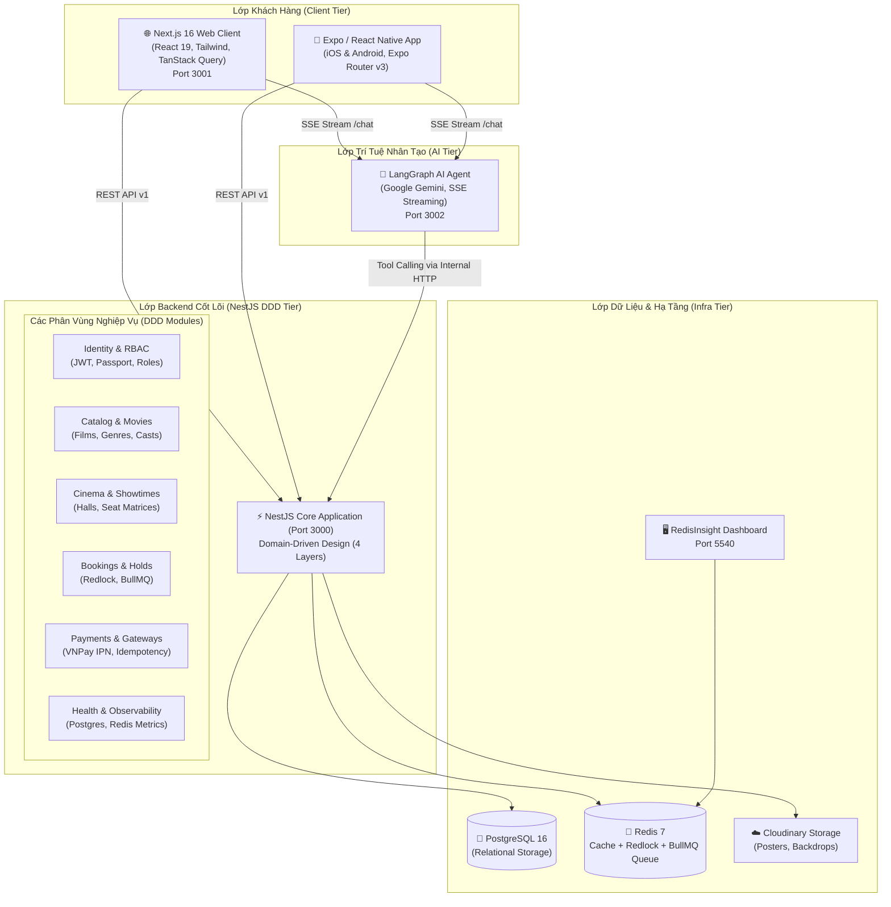
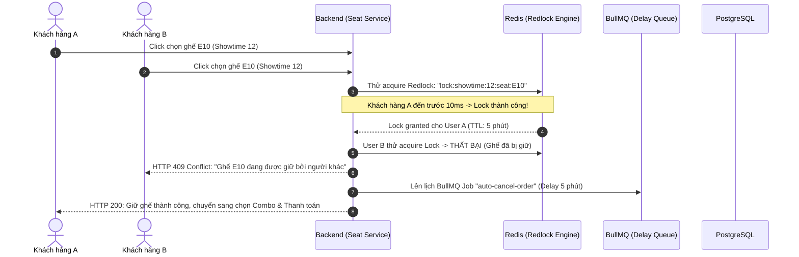

# 02 — Architecture: System Map

Tài liệu này mô tả chi tiết kiến trúc tổng thể, ranh giới các thành phần dịch vụ và luồng dữ liệu của hệ sinh thái **Cinema Booking Agent**.

---

## 🏛️ Sơ Đồ Kiến Trúc Toàn Hệ Thống

---

## 🧩 Cấu Trúc Các Ứng Dụng (Application Boundaries)

### 1. `apps/cinema-backend` (NestJS 11 + DDD)
Tổ chức theo mô hình **Domain-Driven Design** với 4 tầng nghiêm ngặt:
- **Domain Layer (`domain/`):** Chứa các Entity, Value Objects, Domain Rules (ví dụ: quy tắc không cho đặt ghế quá khứ, quy tắc tính giá vé). Không phụ thuộc bất kỳ framework hay ORM nào.
- **Application Layer (`application/`):** Chứa Use Cases, Application Services, DTOs, Event Listeners, và các Facade điều phối giữa các module.
- **Infrastructure Layer (`infrastructure/`):** Triển khai TypeORM Repositories, Redis Adapters, Redlock, BullMQ Queues, cổng thanh toán VNPay, và Mailer (Nodemailer).
- **Presentation Layer (`presentation/`):** Controllers, API DTOs (có validation bằng `class-validator`), Swagger Decorators.

**Module Facade Pattern:** Các module không import repository của nhau mà chỉ tương tác thông qua Facade Interface (ví dụ: `OrdersFacade`, `MoviesFacade`), ngăn ngừa hoàn toàn phụ thuộc vòng.

### 2. `apps/cinema-frontend-v1` (Next.js 16 + React 19)
- **Kiến trúc Feature-Driven (`features/`):** Phân chia theo nghiệp vụ: `auth/`, `movie/`, `cinema/`, `cineplex/`, `booking/`, `ai-agent/`.
- **Server State Management:** Dùng **TanStack Query v5** với cơ chế `staleTime`, `optimisticUpdates` và prefetching trên Server Components.
- **Client State:** **Zustand** quản lý trạng thái chọn ghế, giỏ bắp nước và bước thanh toán.
- **GIS Map & Charts:** Tích hợp **React Leaflet** định vị rạp chiếu phim trực quan.

### 3. `apps/cinema-mobile` (React Native + Expo SDK)
- **Expo Router v3:** Định tuyến dựa trên cấu trúc file (`(tabs)/`, `agent.tsx`, `booking/`).
- **Bảo mật:** Lưu trữ JWT Access Token và Refresh Token qua phần cứng bảo mật `Expo SecureStore`.
- **Real-time AI Chat:** Nhận phản hồi dạng dòng (Streaming Response) từ AI Agent với hiệu ứng gõ chữ mượt mà và bubble chat tối ưu giao diện dark mode.

### 4. `apps/cinema-agent` (LangGraph + Gemini LLM)
- **Stateful Graph Architecture:** Sử dụng mô hình đồ thị trạng thái của LangGraph để theo dõi trạng thái cuộc trò chuyện của người dùng theo từng `session_id`.
- **Tool Calling:** Khi người dùng hỏi *"Tối nay có phim kinh dị nào chiếu ở rạp Landmark không?"*, Agent tự động gọi công cụ `search_showtimes` truyền tham số vào Backend NestJS để lấy kết quả chính xác 100%.

---

## 🔒 Cơ Chế Chống Đặt Trùng Ghế (Concurrency Architecture)

